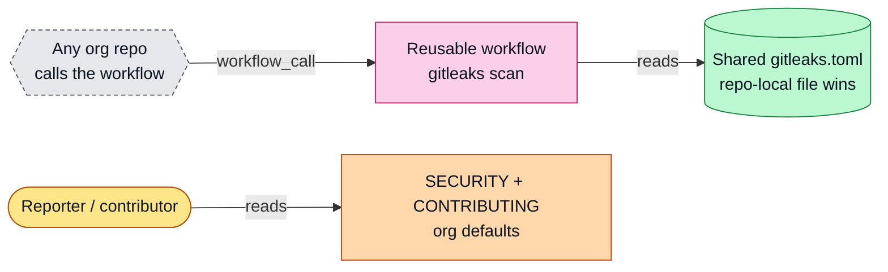

# .github

Default community health files for repositories owned by [thefiredev-cloud](https://github.com/thefiredev-cloud), the home of Kodros and TheFireDev.

GitHub uses a file from this repository when a repository does not have its own copy:

- [SECURITY.md](SECURITY.md): how to report a vulnerability privately
- [CONTRIBUTING.md](CONTRIBUTING.md): how to propose changes

The profile page itself lives in [thefiredev-cloud/thefiredev-cloud](https://github.com/thefiredev-cloud/thefiredev-cloud).

<!-- arch:begin -->
## Architecture

Organization defaults: security and contributing policy, plus a reusable gitleaks secret-scan workflow.



[Full architecture](docs/ARCHITECTURE.md) · Hi-res: [SVG](docs/architecture/whiteboard.svg) · [PNG 3x](docs/architecture/whiteboard@3x.png) · [dark PNG](docs/architecture/whiteboard.dark@3x.png) · [Explorable (Archify)](docs/architecture/dot-github.archify.html) · [Graphify report](docs/architecture/graphify/GRAPH_REPORT.md)
<!-- arch:end -->

## Secret scan

Call the reusable workflow from a repo's workflow file:

```yaml
jobs:
  gitleaks:
    uses: thefiredev-cloud/.github/.github/workflows/gitleaks-reusable.yml@main
```

- Optional input `gitleaks-version`: plain `x.y.z`, default `8.21.2`.
- A repo-local `.gitleaks.toml` replaces the shared `gitleaks/gitleaks.toml`.
- Pull requests scan the base..head range. Other events scan full history.
- Local hook: install `pre-commit`, copy `gitleaks/pre-commit-config.example.yaml` to `.pre-commit-config.yaml`, then run `pre-commit install`. It needs `gitleaks` on PATH.

## License

All rights reserved. See [LICENSE](LICENSE). Licensing questions and contact: [tanner@kodros.ai](mailto:tanner@kodros.ai).
