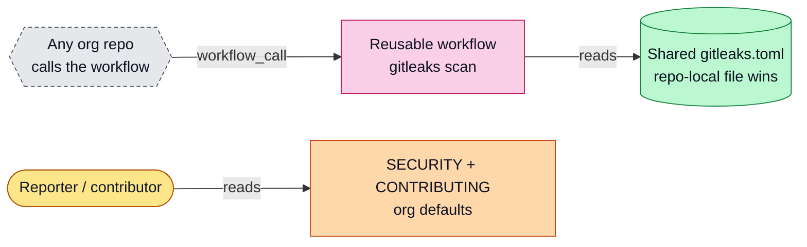

# .github

Default community health files for repositories owned by [thefiredev-cloud](https://github.com/thefiredev-cloud), the home of Mesh and TheFireDev.

GitHub uses a file from this repository when a repository does not have its own copy:

- [SECURITY.md](SECURITY.md): how to report a vulnerability privately
- [CONTRIBUTING.md](CONTRIBUTING.md): how to propose changes

The profile page itself lives in [thefiredev-cloud/thefiredev-cloud](https://github.com/thefiredev-cloud/thefiredev-cloud).

<!-- arch:begin -->
## Architecture

Organization defaults: security and contributing policy, plus a reusable gitleaks secret-scan workflow.

[Full architecture](docs/ARCHITECTURE.md) · Hi-res: [SVG](docs/architecture/whiteboard.svg) · [PNG 3x](docs/architecture/whiteboard@3x.png) · [dark PNG](docs/architecture/whiteboard.dark@3x.png) · [Explorable (Archify)](docs/architecture/dot-github.archify.html) · [Graphify report](docs/architecture/graphify/GRAPH_REPORT.md)
<!-- arch:end -->

## License

MIT. See [LICENSE](LICENSE).
