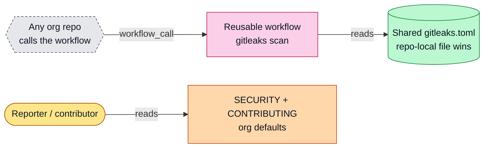
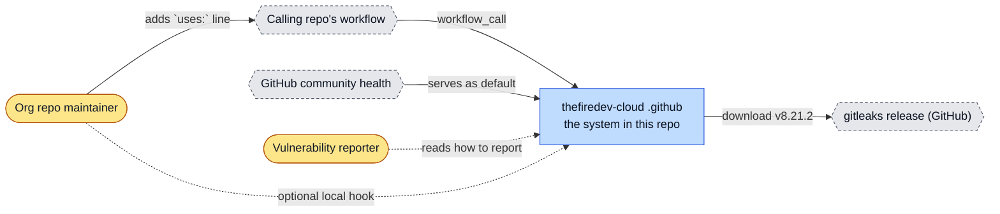
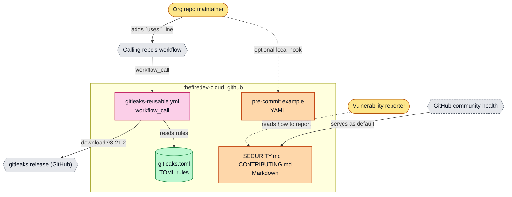
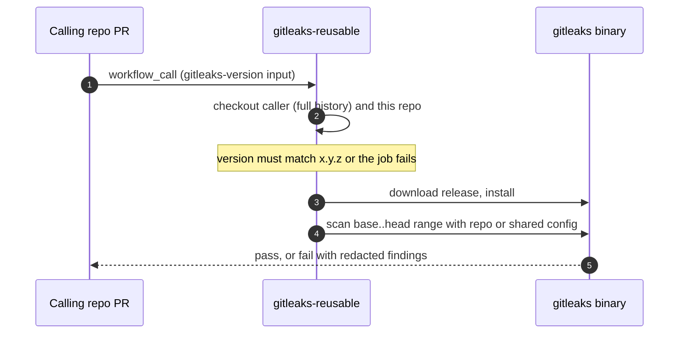
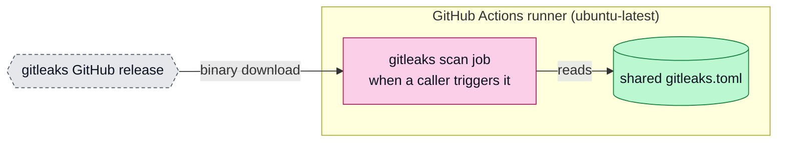

# thefiredev-cloud .github: architecture

<!-- arch-kit:generated -->

> Whiteboard-level structure: what systems exist, what they talk to, and when they run. Evidence-backed; every box below maps to a path listed in [Evidence](#10-evidence).
> Generated by the ArchDocs kit from repo commit `a80387cdf0`. Diagram sources: [`architecture/*.mmd`](architecture/). Hi-res renders sit next to each source.

## 1. Purpose

This is thefiredev-cloud's special `.github` repository. GitHub uses its `SECURITY.md` and `CONTRIBUTING.md` for any repo in the organization that has no copy of its own. It also publishes one reusable GitHub Actions workflow, `gitleaks-reusable.yml`, that any repo can call to scan for leaked secrets with a shared gitleaks config; a repo-local `.gitleaks.toml` wins when present. A pre-commit example sits beside it.

## 2. Whiteboard view

Five boxes: one reusable scan, one shared config, and policy files GitHub serves by default.

Hi-res: [SVG](architecture/whiteboard.svg) · [PNG 3x](architecture/whiteboard@3x.png) · [dark SVG](architecture/whiteboard.dark.svg) · [dark PNG 3x](architecture/whiteboard.dark@3x.png)

Explorable version (Archify, standalone HTML, download and open locally): [`architecture/dot-github.archify.html`](architecture/dot-github.archify.html)

## 3. System context (C4 level 1)

Who and what touches the system from outside.

Hi-res: [SVG](architecture/context.svg) · [PNG 3x](architecture/context@3x.png)

## 4. Containers and components (C4 level 2)

The parts that run or hold data inside the repo's system boundary.

Hi-res: [SVG](architecture/containers.svg) · [PNG 3x](architecture/containers@3x.png)

| Container | Kind | Tech | What it does | Evidence |
|---|---|---|---|---|
| gitleaks-reusable.yml | job | workflow_call | Checks out the caller and this repo, installs a pinned-format gitleaks version, scans the PR range or full history. | [`.github/workflows/gitleaks-reusable.yml#L6-L49`](../.github/workflows/gitleaks-reusable.yml#L6-L49) |
| gitleaks.toml | store | TOML rules | Shared scan config. A repo-local .gitleaks.toml overrides it. | [`gitleaks/gitleaks.toml`](../gitleaks/gitleaks.toml), [`.github/workflows/gitleaks-reusable.yml#L42-L43`](../.github/workflows/gitleaks-reusable.yml#L42-L43) |
| pre-commit example | doc | YAML | Optional local pre-commit hook config. | [`gitleaks/pre-commit-config.example.yaml`](../gitleaks/pre-commit-config.example.yaml) |
| SECURITY.md + CONTRIBUTING.md | doc | Markdown | Org-wide defaults GitHub shows for repos without their own. | [`README.md#L5-L8`](../README.md#L5-L8), [`SECURITY.md`](../SECURITY.md), [`CONTRIBUTING.md`](../CONTRIBUTING.md) |

## 5. Key runtime sequences

### 5.1 A pull request triggers the shared secret scan

Hi-res: [SVG](architecture/sequence-1.svg) · [PNG 3x](architecture/sequence-1@3x.png)

## 6. Data flow and stores

No store. The workflow reads the caller's git history and a TOML config, and reports through the job result. Findings are redacted.

## 7. Deployment and runtime topology

No servers. The workflow runs on GitHub-hosted runners when a repo calls it.

Hi-res: [SVG](architecture/deployment.svg) · [PNG 3x](architecture/deployment@3x.png)

| What | Where | Runs when | Trigger / port | Evidence |
|---|---|---|---|---|
| gitleaks scan | GitHub-hosted runner | Whenever a calling repo's workflow runs (its own triggers) | workflow_call | [`.github/workflows/gitleaks-reusable.yml#L7-L9`](../.github/workflows/gitleaks-reusable.yml#L7-L9) |

## 8. Failure modes and how to see them

| Failure | What the user sees | How to see it | Evidence |
|---|---|---|---|
| Secret found | Job fails; output is redacted | gitleaks step log in the caller's run | [`.github/workflows/gitleaks-reusable.yml#L44-L49`](../.github/workflows/gitleaks-reusable.yml#L44-L49) |
| Bad gitleaks-version input | Job exits 1 before download | `bad gitleaks-version` message | [`.github/workflows/gitleaks-reusable.yml#L32-L33`](../.github/workflows/gitleaks-reusable.yml#L32-L33) |
| Caller pins `@main` and main changes | Every caller picks up the change | Review changes to this repo as org-wide changes | [`.github/workflows/gitleaks-reusable.yml#L1-L5`](../.github/workflows/gitleaks-reusable.yml#L1-L5) |

## 9. State machine

No state machine in this repo.

## 10. Evidence

Every path below exists at the pinned commit; links are relative to `docs/`.

| Path | Why it matters |
|---|---|
| [`.github/workflows/gitleaks-reusable.yml`](../.github/workflows/gitleaks-reusable.yml) | The reusable secret-scan workflow. |
| [`gitleaks/gitleaks.toml`](../gitleaks/gitleaks.toml) | Shared gitleaks rules. |
| [`gitleaks/pre-commit-config.example.yaml`](../gitleaks/pre-commit-config.example.yaml) | Optional pre-commit hook example. |
| [`SECURITY.md`](../SECURITY.md) | How to report a vulnerability privately. |
| [`CONTRIBUTING.md`](../CONTRIBUTING.md) | How to propose changes. |
| [`README.md`](../README.md) | What the defaults are for. |

Collected mechanically by the kit ([`architecture/facts.json`](architecture/facts.json), not hand-edited):

- CI: `.github/workflows/gitleaks-reusable.yml`
- external hosts seen in source: `github.com`

Graphify (local AST, no LLM) read this repo: 10 nodes, 10 edges, 3 communities. Most connected: `Security policy` (4), `.github` (2), `Contributing` (1), `License` (1), `Reporting a vulnerability` (1).

- Report: [`architecture/graphify/GRAPH_REPORT.md`](architecture/graphify/GRAPH_REPORT.md)
- Interactive graph: [`architecture/graphify/graph.html`](architecture/graphify/graph.html) (26 KB, download and open locally)
